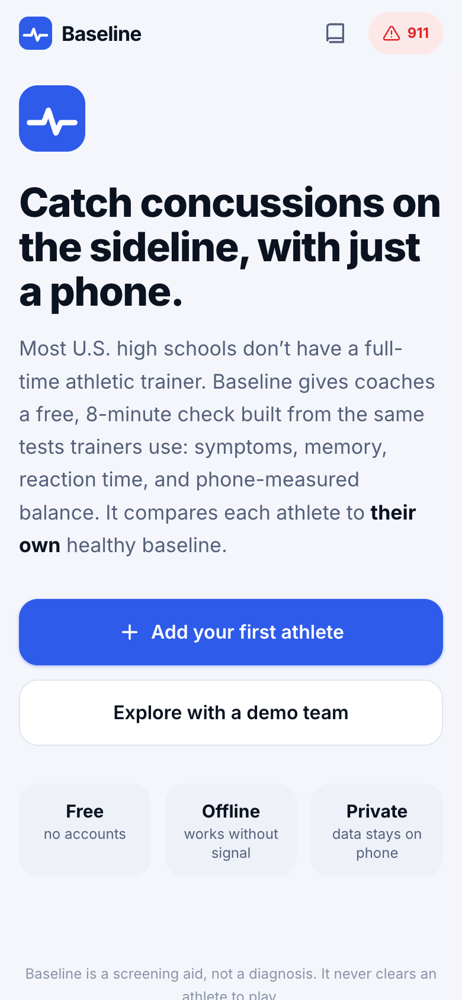
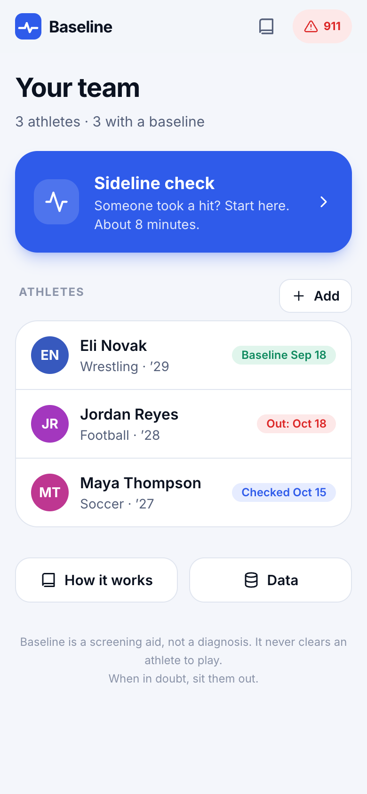
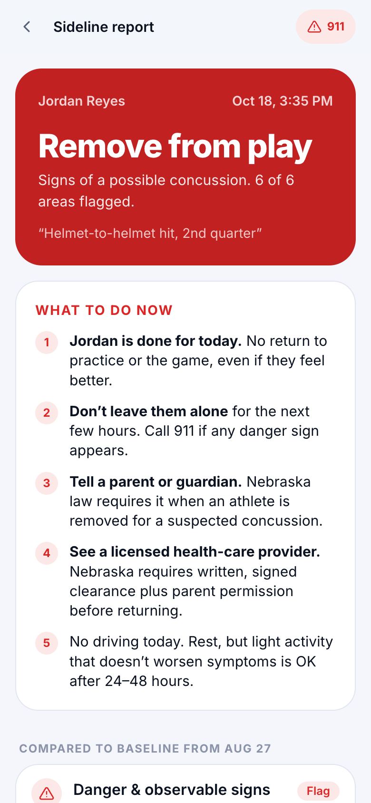

# Baseline: sideline concussion check

**A free, offline web app that helps high-school coaches spot concussions using only a phone, by comparing each athlete to their own healthy baseline.**

**Live app:** https://baseline-concussion.vercel.app · **Built for the 2026 Congressional App Challenge (NE-02)**

<p>
  
  
  
  
</p>

## The problem

- **63% of U.S. public high schools don’t have a full-time athletic trainer** (Pryor et al., *J Athl Train*, 2015).
- **About half of high-school football concussions go unreported** (McCrea et al., *Clin J Sport Med*, 2004).
- Nebraska’s Concussion Awareness Act requires a coach to remove an athlete who is *reasonably suspected* of a concussion. Without a trainer, the coach has to judge that alone.

The tools trainers use (symptom scales, memory tests, balance scoring, eye-movement screens) are evidence-based. But they’re on paper, need training to score, and are hard to compare with how the athlete normally performs. Commercial apps cost money and need accounts.

## What Baseline does

1. **Before the season:** each athlete records a ~8-minute **baseline** while healthy.
2. **After a hit:** the coach taps **Sideline check**. Baseline runs the same tests and compares the athlete **to themselves**.
3. **Result:** *Call 911*, *Remove from play*, or *No changes detected*. It never says "cleared." A licensed provider must clear return to play.

### The six checks

| # | Check | Based on | How the phone helps |
|---|---|---|---|
| 1 | Danger & observable signs | Concussion Recognition Tool | Any red flag ends the check and shows a 911 screen |
| 2 | 22 symptoms (0–6) | SCAT symptom scale | Flags any symptom worse than baseline |
| 3 | Memory & thinking | Standardized Assessment of Concussion | Phone reads the word list aloud, shows the examiner the correct answers, and times the 5-minute delay |
| 4 | Reaction time | Go/no-go task | 24 trials timed to the ms; **Mann–Whitney test** against baseline trials |
| 5 | Balance | Modified BESS | **Accelerometer** measures sway objectively instead of a person counting wobbles |
| 6 | Eyes & motion | VOMS (Mucha et al., 2014) | Animated targets + metronome; flags a ≥2-point symptom rise |

### Built for a real sideline
- **Works offline:** it's a PWA, so after the first load it works with no signal. Add it to your home screen.
- **Private:** no accounts and no server. All data stays on the device (localStorage). Exports are anonymized.
- **Fast:** stop early once an athlete is clearly out. A 911 button is on every screen.
- **Voice-guided** balance test (eyes are closed), dark mode for night games, and a printable/shareable report for parents and doctors.
- **Baseline effort check:** warns if a baseline looks rushed or sandbagged, a known problem with baseline testing.

## How accurate is it?

Short version: **based on published studies of the same tests, we estimate Baseline catches roughly 85–95% of concussions** when a valid baseline exists and the check happens the same day. Specificity is lower because any changed domain triggers a flag. That's on purpose: missing a concussion is worse than a false alarm. **Baseline itself has not been clinically validated.** See [docs/SCIENCE.md](docs/SCIENCE.md) for the evidence, the reasoning, and the limitations.

We *can* measure how often the app raises false alarms on healthy athletes. Volunteers take two baselines a few days apart, and [`scripts/analyze_reliability.py`](scripts/analyze_reliability.py) computes test-retest reliability (ICC) and the false-positive rate.

## How it works (code tour)

```
src/lib/balance.ts     accelerometer → gravity removal → horizontal sway (milli-g) + balance-error count
src/lib/scoring.ts     compares a check to the baseline, domain by domain → verdict
src/lib/thresholds.ts  every decision cutoff, with the study it came from
src/lib/stats.ts       median, Mann–Whitney U test, normal CDF (no dependencies)
src/steps/*            the nine test screens (reaction timing done outside React for ms accuracy)
src/screens/*          home, athlete, runner, report, learn, emergency, data
scripts/analyze_reliability.py   test-retest study analysis (ICC(2,1), SEM, MDC95, false-positive rate)
```

**Balance algorithm.** The phone is held against the chest. A one-pole low-pass filter (0.2 Hz) tracks gravity. Subtracting it leaves body motion, which is smoothed at 5 Hz and projected onto the plane perpendicular to gravity. Sway is the RMS of that horizontal acceleration in milli-g. Jolts above 1.2 m/s² (stepping or stumbling) count as balance errors. Unit tests check that the score scales with sway and doesn't depend on how the phone is rotated.

**Reaction timing.** Stimulus onset is the `requestAnimationFrame` timestamp of the frame that paints the color change. Taps use the `PointerEvent.timeStamp`. Both share the same high-resolution clock, so React re-renders add no delay.

## Run it locally

```bash
npm install
npm run dev        # http://localhost:5173
npm test           # unit tests (scoring, statistics, balance analysis)
npm run build      # production build in dist/
```

The balance test needs a phone with a motion sensor and HTTPS (any Vercel deploy works). On a laptop, tap **Explore with a demo team** to see finished reports.

## Tech
React 19 + TypeScript, Vite, Tailwind CSS 4, vite-plugin-pwa, Vitest. No charting, UI, or analytics libraries; charts are hand-written SVG.

## Disclaimer
Baseline is a screening aid for coaches, not a medical device or a diagnosis. It never clears an athlete to play. **When in doubt, sit them out.**
